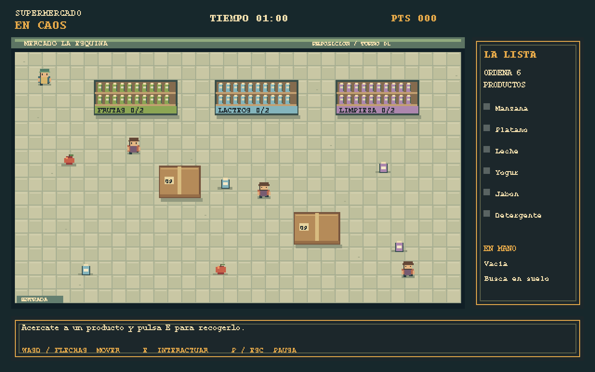

# Supermercado en Caos

<<<<<<< Updated upstream
## 📝 Descripción

**Supermercado en Caos** es un videojuego 2D desarrollado en Java (Swing/Java2D) como proyecto final del curso de Programación Orientada a Objetos (POO) de la Universidad Peruana Cayetano Heredia.

El jugador asume el papel de un repositor de supermercado que debe organizar productos que se encuentran esparcidos por el suelo antes de que termine el tiempo. Durante la partida, tendrá que recorrer los pasillos, recoger productos (uno a la vez), colocarlos en los estantes correspondientes y evitar chocar con clientes apurados y obstáculos sólidos.
=======
Juego cenital de reposicion en Java 17+, Java2D y Swing, sin dependencias externas.
Un nivel completo: seis entregas en 180 segundos.

## Ejecutar

Extraer todo el ZIP. Con Java 17 o superior: `java -jar dist/SupermercadoEnCaos.jar`.
Para compilar los fuentes: `ejecutar.bat` (Windows) o `bash ejecutar.sh` (Linux/macOS), con un JDK 17+.
Si Java de PATH falla, configurar JAVA_HOME al JDK. En IntelliJ abrir esta carpeta y ejecutar `com.supermercado.Main`.

## Controles y objetivo
>>>>>>> Stashed changes

- Menu: arriba/abajo o W/S, Enter para Jugar/Iniciar, Instrucciones o Salir.
- Partida: WASD o flechas para moverse, E para recoger o entregar cerca del objeto.
- P o Esc pausa/reanuda. Cambiar de ventana pausa y limpia teclas.
- Enter o R vuelve a jugar despues de victoria o derrota.
- Solo se lleva un producto. Cada entrega en la categoria correcta vale 100 puntos.
- Los estantes y cajas bloquean. Los clientes restan cinco segundos al contacto, con un segundo de inmunidad.
- Se gana entregando los seis productos; se pierde al agotarse el reloj.

<<<<<<< Updated upstream
## 🎮 Controles

- **WASD / Flechas:** Mover al personaje.
- **Tecla E:** Recoger un producto del suelo o entregarlo en un estante.
- **Tecla P / ESC:** Pausar o reanudar la partida.
=======
## Arte y alcance

Paleta limitada, baldosas, estantes, cajas, productos y personajes originales dibujados por Java.
Animacion de pasos, orientacion vertical, flotacion de productos y parpadeo de inmunidad.
El atlas PNG en assets documenta las formas; el juego dibuja desde el codigo, sin archivos necesarios en ejecucion. 
No hay audio ni niveles adicionales.

## Arquitectura y rubrica
>>>>>>> Stashed changes

Ver docs/ARQUITECTURA.md, docs/UML.svg y docs/UML.drawio. Ocho clases de dominio mas cuatro auxiliares reales.
El enum de pantallas no se presenta como patron State.
Consultar docs/GIT.md y docs/EXPOSICION.md.

<<<<<<< Updated upstream
## 🎯 Objetivo del juego

El objetivo principal es organizar todos los productos en sus estantes correctos antes de que el temporizador llegue a cero. 

El jugador obtiene puntos por colocar correctamente los productos, pero perderá valiosos segundos de su tiempo si colisiona con los clientes que recorren la tienda.

---

## 📦 Productos y Categorías (Implementación Actual)

El juego cuenta actualmente con 6 productos divididos en 3 categorías clave. El jugador deberá identificar el estante correcto para cada uno:

| Categoría | Productos |
|---|---|
| **Frutas** | Manzana, Plátano |
| **Limpieza** | Detergente, Jabón |
| **Lácteos** | Leche, Yogur |

---

## 🚧 Obstáculos y Personajes

- **El Repositor (Jugador):** Personaje principal. Solo puede cargar un producto a la vez.
- **Clientes:** Personajes secundarios que patrullan la tienda. Si el jugador choca con ellos, sufrirá una penalización de tiempo.
- **Cajas y Estantes:** Obstáculos sólidos que bloquean el paso y obligan al jugador a buscar rutas alternas.
- *(En desarrollo para la versión final: Supervisores, derrames en el piso y carritos descontrolados).*

---

## 🏆 Sistema de Puntuación y Tiempo

Para el **Nivel 1 (Turno de apertura)**, las reglas de puntuación y tiempo son las siguientes:

- **Tiempo inicial:** 180 segundos (3 minutos).
- **Producto colocado correctamente:** +100 puntos.
- **Chocar con un cliente:** -5 segundos de penalización (otorga una breve inmunidad tras el choque).
- **Condición de Victoria:** Entregar los 6 productos antes de que el reloj llegue a 00:00.

---

## 💻 Programación Orientada a Objetos (POO)

El proyecto está diseñado bajo una arquitectura limpia que demuestra el dominio de los siguientes pilares de la POO:

- **Abstracción y Herencia:** Clases abstractas como `Personaje` (de la cual heredan `Jugador` y `Cliente`) y `Obstaculo` (padre de `Estante`).
- **Polimorfismo:** El bucle de juego actualiza a todas las entidades (movimiento y colisiones) mediante llamadas polimórficas al método `update()`.
- **Encapsulamiento:** Protección de atributos críticos (puntos, tiempo, coordenadas) mediante métodos de acceso controlados.
- **Asociación, Agregación y Composición:** Evidenciadas en la relación del jugador con los productos, los estantes que agrupan los objetos entregados, y el `Juego` que compone y gestiona el `Nivel` completo.
=======
## Verificacion

`probar.bat` o `bash probar.sh` compila y ejecuta pruebas sin bibliotecas externas.
Las pruebas cubren movimiento, colisiones, transporte, categoria incorrecta, victoria, derrota, pausa,
inmunidad, controles y navegacion a instrucciones. Generan capturas del panel Swing.
El recorrido automatizado usa el resolvedor real de colisiones; no simula todas las pulsaciones de un jugador humano.
>>>>>>> Stashed changes
