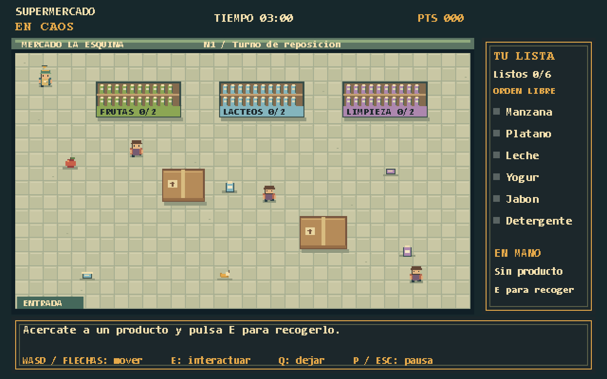

# Supermercado en Caos

**Supermercado en Caos** es un videojuego cenital 2D desarrollado en Java (versión 17+, Swing / Java2D) sin dependencias ni bibliotecas externas. Proyecto desarrollado para el curso de Programación Orientada a Objetos (POO) de la Universidad Peruana Cayetano Heredia.

El nivel 1 conserva sus seis entregas y dispone de 180 segundos (3 minutos). El nivel 2, **Pasillo concurrido**, tiene seis entregas libres, 135 segundos y cuatro clientes con dos comportamientos (Strategy): patrulla continua y patrulla con pausas. Incluye patrullas horizontales y verticales, y los estantes estan distribuidos entre la parte superior, derecha e inferior del mapa. La campaña conserva puntos y permite reintentar. Los niveles 3–6 y la integracion de State y Observer siguen pendientes del equipo. Los cambios U1, U2 y U3 se explican en [docs/GUIA_JUAN.md](docs/GUIA_JUAN.md).



---

## 🚀 Ejecución y Compilación

1. **Ejecutar JAR:**
   * Extraer todo el ZIP.
   * Con Java 17 o superior instalado, ejecutar:
     ```bash
     java -jar dist/SupermercadoEnCaos.jar
     ```
2. **Compilar desde código fuente:**
   * **Windows:** Ejecutar `ejecutar.bat` (requiere JDK 17+).
   * **Linux / macOS:** Ejecutar `bash ejecutar.sh` (requiere JDK 17+).
   * Si el comando `java` del sistema falla, asegúrate de configurar la variable `JAVA_HOME` apuntando a tu JDK.
   * **Entorno IDE:** En IntelliJ (o similares), abrir esta carpeta raíz y ejecutar la clase principal `com.supermercado.Main`.

---

## 🎮 Controles y Dinámica de Juego

* **Navegación en Menús:** Teclas `Arriba` / `Abajo` o `W` / `S`. Presionar `Enter` para seleccionar *Jugar/Iniciar*, *Instrucciones* o *Salir*.
* **Movimiento del Personaje:** Teclas `WASD` o `Flechas direccionales`.
* **Interacción (`E`):** Presionar la tecla `E` estando cerca de un objeto para recogerlo del suelo o entregarlo en su estante.
* **Dejar producto (`Q`):** Deja lo transportado en la posicion actual y libera la mano. Permite corregir una recogida fuera de turno.
* **Pausa (`P` / `ESC`):** Pausa o reanuda la partida. Cambiar el foco de la ventana pausa el juego automáticamente y limpia las teclas presionadas.
* **Victoria (`Enter`):** Avanza al siguiente nivel disponible; si falta su configuración, conserva el resultado y lo indica.
* **Derrota (`Enter`):** Reintenta el nivel actual y restaura la puntuación anterior al intento.
* **Nueva campaña (`R`):** Desde victoria o derrota, vuelve al nivel 1 con cero puntos. Tras completar el nivel 6, `Enter` también inicia una campaña nueva.

---

## 🎯 Objetivo y Reglas de Juego

* **Transporte:** El repositor solo puede llevar un producto a la vez.
* **Entregas ordenadas:** Cuando la configuracion lo requiere, las categorias de la lista definen la secuencia. La HUD muestra `SIGUE`. Una entrega fuera de turno conserva el producto y no da puntos. Se puede dejar con Q; los productos de la misma categoria son intercambiables.
* **Puntuación:** Cada entrega realizada en la categoría correcta otorga **+100 puntos**.
* **Obstáculos:** Las cajas y los estantes actúan como objetos sólidos que bloquean el paso.
* **Clientes:** Los clientes patrullan por la tienda. Al chocar con ellos, se aplican **-5 segundos** de penalización al reloj, otorgando **1 segundo de inmunidad temporal** tras el contacto.
* **Condición de Victoria:** Se cumple el objetivo de la configuración actual antes de que expire el tiempo: seis entregas libres en los niveles 1 y 2. Cada entrega suma 100 puntos; los puntos de intentos fallidos se descartan al reintentar. La campaña termina únicamente al completar el nivel 6, cuando sus configuraciones estén integradas. Los niveles ordenados se habilitan mediante `entregasEnOrden(true)`; se incluye una demostracion aislada para probar esa regla sin modificar la campaña.
* **Condición de Derrota:** Se pierde automáticamente si el temporizador llega a 00:00.

---

## 📦 Productos y Categorías

El juego cuenta con 6 productos repartidos en 3 categorías bien definidas:

| Categoría | Productos Incluidos |
| :--- | :--- |
| **Frutas** | Manzana, Plátano |
| **Lácteos** | Leche, Yogur |
| **Limpieza** | Detergente, Jabón |

---

## 🚧 Obstáculos y Personajes

* **El Repositor (Jugador):** Personaje principal controlado por el jugador. Solo puede cargar un producto a la vez.
* **Clientes:** Personajes secundarios que patrullan la tienda de forma autónoma. Al colisionar con ellos, penalizan el tiempo restante.
* **Cajas y Estantes:** Obstáculos sólidos que bloquean el paso y delimitan los pasillos.
* *(En desarrollo para la versión final: Supervisores, derrames en el piso y carritos descontrolados)*.

---

## 🎨 Arte y Alcance Visual

* **Gráficos Originales:** Estilo pixel art original dibujado mediante Java2D (baldosas, mobiliario, productos y personajes) con una paleta limitada y coherente.
* **Efectos Visuales:** Animación de pasos, orientación vertical, flotación de productos e indicadores de parpadeo para la inmunidad.
* **Atlas de Texturas:** El archivo `atlas PNG` ubicado en la carpeta `assets` documenta las formas originales. Sin embargo, el juego drena y dibuja directamente desde código, por lo que no requiere archivos externos durante la ejecución.
* **Alcance:** Sin audio. Nivel 1 original y nivel 2 Pasillo concurrido. No hay configuraciones de producto para niveles 3–6. El tiempo de 135 segundos es un valor inicial que el equipo debe ajustar jugando. El texto de menus, HUD y etiquetas se dibuja a resolucion de ventana con suavizado; solo el arte del mundo se escala como pixel art.

---

## 🏛️ Arquitectura y Cumplimiento de Rúbrica

* **Estructura:** Modelo, entrada y presentación separados; `ConfiguracionNivel` y `CatalogoNiveles` definen escenarios sin duplicar movimiento ni colisiones.
* **Documentación:** Ver detalles técnicos en `docs/ARQUITECTURA.md`, `docs/UML.svg` y `docs/UML.drawio`.
* **Detalles Técnicos:** El `enum` de manejo de pantallas se utiliza exclusivamente para la selección de vistas y no se presenta como un patrón de diseño State.
* **Cambios e integración:** Consultar [docs/GUIA_JUAN.md](docs/GUIA_JUAN.md). Strategy esta implementado para el movimiento de clientes. Esta rama no implementa State ni Observer.

---

## 🧪 Verificación y Pruebas Automatizadas

* **Ejecutar Pruebas:** Ejecuta `probar.bat` (Windows) o `bash probar.sh` (Linux/macOS) para compilar y correr la suite de pruebas sin librerías externas.
* **Cobertura de Pruebas:** Las pruebas automáticas evalúan el movimiento, colisiones, transporte, entregas en categorías incorrectas, victoria, derrota, pausa, inmunidad, respuesta de controles y navegación hacia las instrucciones. Además, generan capturas directas del panel Swing en `build/capturas-pruebas/`, nunca dentro de `docs/`. La suite adicional verifica configuración, campaña, puntuación, reintentos y finalización con fixtures de seis etapas exclusivas de pruebas.
* **Nota sobre la ruta automatizada:** El recorrido automático utiliza el resolvedor real de colisiones del modelo y pasos de actualización entre segmentos; no simula todas las pulsaciones físicas de un jugador humano.

## Demostracion aislada de entregas ordenadas

Despues de `probar.bat` o `bash probar.sh`, ejecutar desde la raiz:

```text
java -cp build/classes com.supermercado.PruebasJuan --demo-orden
```

Tambien se puede ejecutar esa clase desde IntelliJ con el argumento `--demo-orden`.
Abre una configuracion de prueba de tres productos con secuencia FRUTAS, LACTEOS, FRUTAS.
Recoger Leche primero permite probar el rechazo en LACTEOS y la recuperacion con Q.
Es una demostracion de U2, no un tercer nivel de campaña; no se incluye en el JAR de produccion.

## Probar directamente el nivel 2

Despues de compilar las pruebas se puede ejecutar:

```text
java -cp build/classes com.supermercado.PruebasJuan --demo-nivel2
```

Abre Pasillo concurrido con los 600 puntos del primer nivel. Este lanzador solo es para probar;
el juego normal sigue avanzando al nivel 2 despues de completar el primero y pulsar Enter.
